# Felhasználói kézikönyv

Ez a kézikönyv egy elképzelt, de valósághű munkafolyamaton vezet végig: egy szennyvíztisztító telep adatainak **feltöltésén** (1. rész), majd a kész digitális iker **napi használatán** (2. rész). A képernyőképek a rendszerben található „Minta szennyvíztisztító telep” adataival készültek; ezen a telepen minden lépés kipróbálható.

**A példa szereplői**

| Szereplő | Szerepkör | Feladata |
|---|---|---|
| Admin | Szervezeti admin | telephelyet és felhasználókat hoz létre |
| Adatgazda | Szerkesztő | felveszi a telep szerkezetét, feltölti a panorámákat és a 3D adatokat, összerendel |
| Karbantartó | Megtekintő | keres, nézeget, adatlapot olvas – módosítani nem tud |

---

## Tartalom

- [Alapfogalmak](#alapfogalmak)
- [A képernyő](#a-képernyő)
- [Üzemmódok és jogosultságok](#üzemmódok-és-jogosultságok)
- [1. rész – Az adatok feltöltése](#1-rész--az-adatok-feltöltése)
  - [1. Telephely](#1-telephely)
  - [2. Helyszíni szerkezet: épületek, szintek, helyiségek](#2-helyszíni-szerkezet-épületek-szintek-helyiségek)
  - [3. Alaprajz a szintekhez](#3-alaprajz-a-szintekhez)
  - [4. Funkcionális szerkezet és műszaki adatok](#4-funkcionális-szerkezet-és-műszaki-adatok)
  - [5. Panorámák](#5-panorámák)
  - [6. 3D adatok](#6-3d-adatok)
  - [7. A berendezések helye](#7-a-berendezések-helye)
  - [8. Megjelenések: infopont, pont, doboz, modellelem](#8-megjelenések-infopont-pont-doboz-modellelem)
  - [9. Ellenőrzés és véglegesítés](#9-ellenőrzés-és-véglegesítés)
- [2. rész – Az adatok használata](#2-rész--az-adatok-használata)
- [Véglegesített adat módosítása](#véglegesített-adat-módosítása)
- [Gyakori kérdések](#gyakori-kérdések)
- [Függelék: táblázatsablonok és fájlformátumok](#függelék-táblázatsablonok-és-fájlformátumok)

---

## Alapfogalmak

| Fogalom | Jelentése |
|---|---|
| **Telephely** | Egy üzem vagy telep. Minden adat egy telephelyhez tartozik; a fejléc bal oldalán választható. |
| **Rekord (elem)** | Egy nyilvántartott dolog: épület, szint, helyiség, technológiai vonal, berendezés. Saját adatlapja van. |
| **Helyszíni fa** | *Hol van?* – épület › szint › helyiség (kültéri terület). |
| **Funkcionális fa** | *Mire való?* – technológiai vonal › berendezés. |
| **Hely** | Egy berendezés helye a helyszíni fában. Ugyanaz a berendezés mindkét fában megjelenik: a funkcionálisban a vonala alatt, a helyszíniben a helye alatt. |
| **Megjelenés** | Ahol a rekord a képeken látszik: **pont** az alaprajzon vagy a 3D-ben, **infopont** egy panorámán, **doboz** (térrész) a 3D-ben, **modellelem** egy 3D modellben. Egy rekordnak egy helye van; egy panorámán egy infopontja. |
| **Panoráma** | 360°-os gömbpanoráma-fotó, egy rekordhoz és egy szinthez kötve. |
| **Véglegesítés** | A rekord „élesbe” állítása: utána minden változáshoz indoklás kell, és a változások visszakereshetők. |

## A képernyő

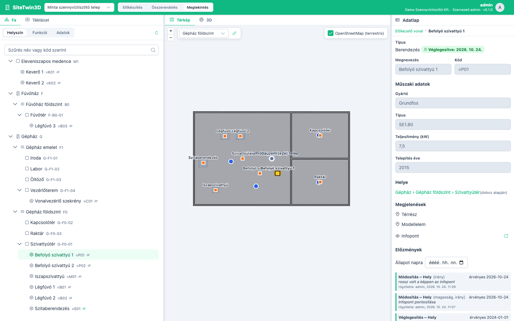

| Terület | Tartalom |
|---|---|
| **Fejléc** | telephely-választó, üzemmód (Előkészítés · Összerendelés · Megtekintés), adminnak *Telephelyek* és *Háttérrétegek*, jobbra a felhasználói menü |
| **Bal oldal** | **Fa** (nézetek: *Helyszín*, *Funkció*, *Adatok*) és **Táblázat** fül |
| **Középen** | **Térkép** (alaprajz, szintválasztó) és **3D** fül; a megnyitott panoráma a térkép mellett jelenik meg |
| **Jobb oldal** | **Adatlap**: a kijelölt rekord adatai, helye, megjelenései, előzményei |

A kijelölés **közös**: ha bármelyik nézetben (fa, táblázat, térkép, panoráma, 3D) kijelöl egy rekordot, a többi nézet is odaugrik.

## Üzemmódok és jogosultságok

| Üzemmód | Mire való | Ki használhatja |
|---|---|---|
| **Előkészítés** | szerkezet felvétele, adatok szerkesztése, panorámák és 3D modellek feltöltése, importok | Szerkesztő, Szervezeti admin |
| **Összerendelés** | a rekordok megjelenéseinek elhelyezése (infopont, pont, doboz, modellelem) | Szerkesztő, Szervezeti admin |
| **Megtekintés** | keresés, nézelődés, adatlapok olvasása – semmi nem módosítható | mindenki |

A Megtekintő szerepkörű felhasználó csak a Megtekintés módot látja. Ha egy felhasználónak telephelyenként van jogosultsága, a többi telephelyet nem látja.

---

## 1. rész – Az adatok feltöltése

A példában az Adatgazda egy szennyvíztisztító telepet vesz fel: két épület (Gépház, Fúvóház), három szint, egy kültéri medence, egy technológiai vonal (Előkezelő vonal) berendezésekkel, néhány panoráma és egy 3D modell. Az ajánlott sorrend:

1. telephely → 2. helyszíni szerkezet → 3. alaprajz → 4. funkcionális szerkezet → 5. panorámák → 6. 3D adatok → 7. helyek → 8. megjelenések → 9. véglegesítés.

### 1. Telephely

*Szervezeti admin, Előkészítés mód.*

1. Fejléc → **Telephelyek** → **Új telephely**.
2. Adja meg a **nevet**, a **referenciapontot** (hosszúság, szélesség – vagy **Referenciapont a térképen**, és kattintson a telep közepére) és az **alapmagasságot** (a telep 0 szintjének ellipszoidi magassága méterben).
3. Opcionálisan rajzolja meg a telep **határát** (*Határ rajzolása a térképen*, dupla kattintás zárja le).
4. **Mentés**. Az új telephely kiválasztódik a fejlécben.

> Tipp: a felhasználókat a felhasználói menü → *Felhasználók* alatt lehet felvenni; a *Telephelyi jogok* résznél korlátozható, hogy ki melyik telephelyet lássa.

### Típusok és saját mezők (szervezeti admin)

*Előkészítés mód, fejléc → **Típusok**.* Itt dől el, milyen leíró adatokat lehet egy elemhez felvinni.

- **Alaptípusokhoz saját mezők:** válassza ki pl. a **Helyiség** típust → **Mező hozzáadása** → felirat (pl. *Alapterület (m²)*), fajta (*Szöveg, Egész szám, Szám, Igen/nem, Választólista, Dátum*), *Kötelező* → **Mentés**. A mezők a szervezet minden helyiségénél megjelennek az adatlapon, a táblázat oszlopaiban és a táblázatos importban; más szervezetet nem érintenek.
- **Új saját típus:** **Új típus** → megnevezés (a kód magától képződik), fa (*Helyszín* vagy *Funkció*), szükség esetén *Szint típus*, mezők → **Mentés**. Ezután a fában az új típusú elem is létrehozható.
- A mezők sorrendje (nyilakkal) az adatlap és a táblázat oszlopainak sorrendje. Egy mező törlésekor a már beírt értékek megmaradnak, csak nem jelennek meg.

### 2. Helyszíni szerkezet: épületek, szintek, helyiségek

*Előkészítés mód, Fa fül, Helyszín nézet.*

1. Ha nincs kijelölve semmi, a **+** (*Új gyökérelem*) gyökérszintű elemet hoz létre: típus **Épület**, megnevezés *Gépház*, kód *G*.
2. Jelölje ki a Gépházat, majd **+** (*Új gyermekelem*): típus **Szint**, megnevezés *Gépház földszint*, kód *F0*. A szintnél kötelező a **Padlómagasság az alapmagasságtól (m)** – a földszint 0, az emelet pl. 4,5. A *Belmagasság* a 3D szintvágáshoz kell.
3. A szint alá vegye fel a **helyiségeket** (Szivattyútér, Kapcsolótér, Raktár …), kültéri létesítményhez **Kültéri terület** típust (Eleveniszapos medence).
4. Elrontott szerkezet javítása: az elemek **áthúzhatók** másik szülő alá (a rendszer megerősítést kér), törlésnél a teljes részfa törölhető.

> A kódok (pl. *G-F0-01*) később a táblázatos importoknál azonosítják a rekordokat – érdemes egyedi, beszédes kódokat adni.

### 3. Alaprajz a szintekhez

*Előkészítés mód, Térkép fül.*

Az alaprajzot nem itt kell feltölteni: a MapManagerben publikált rétegre hivatkozunk.

1. A térkép bal felső sarkában válassza ki a szintet (*Gépház földszint*).
2. **Alaprajzok kezelése** (képek ikon) → név (*Építészet*), forrás (*MapManager*), réteg (pl. `ceg:alaprajz`), szintszűrő (pl. `szint = 'F0'`) → **Új**.
3. Az alaprajz megjelenik a térképen; ez lesz a panorámák és a pontok elhelyezésének alapja.

**Háttérrétegek (pl. ortofotó, közmű, OSM):** fejléc → **Háttérrétegek** (szervezeti admin) → név, forrás (*Külső WMS* vagy *MapManager*), réteg (`munkaterület:réteg`), cím, **Vetület**, hatókör → **Új**. Ha a szolgáltatás csak EOV-ban ad képet (pl. EOV-ban gyorsítótárazott réteg), a vetület legyen *EOV (EPSG:23700)*: a térkép EOV-ban kéri le, és maga vetíti át. Egy réteg adatai a ceruza gombbal utólag is módosíthatók. Ha egy réteg nem tölthető be, a térkép jobb felső sarkában a neve narancssárga figyelmeztetést kap; a jel fölé víve látszik az ok.

### 4. Funkcionális szerkezet és műszaki adatok

*Előkészítés mód.*

**Kézzel:** Fa → *Funkció* nézet → **+**: típus **Technológiai vonal** (*Előkezelő vonal*, kód *=L01*), alá **Berendezés** típusú elemek (*Befolyó szivattyú 1*, *=P01* …). A műszaki adatokat (gyártó, típus, teljesítmény, telepítés éve) az adatlapon lehet kitölteni, **Mentés**.

**Táblázatból (sok berendezésnél ajánlott):**

1. **Táblázat** fül → válassza ki a típust (*Berendezés*) → **Importálás** (fájl-import ikon).
2. Válassza ki a CSV vagy XLSX fájlt. Az oszlopokat a rendszer a fejléc alapján hozzárendeli (kód, megnevezés, műszaki adatok); ez kézzel módosítható.
3. *Új elemek szülője*: pl. a kijelölt technológiai vonal.
4. **Importálás**. A meglévő elemek a kód alapján frissülnek, a többi új elemként jön létre. Ha bármelyik sor hibás, **semmi nem mentődik**, és a hibák soronként megjelennek.

**MapManager-rétegből:** ha a berendezések már szerepelnek a MapManagerben, a Táblázat fül **MapManager-réteg kötése** gombjával vázrekordok hozhatók létre; ezek leíró adatai mindig a MapManagerből olvasódnak (itt csak olvashatók).

### 5. Panorámák

*Előkészítés mód, Térkép fül.*

**Feltöltés**

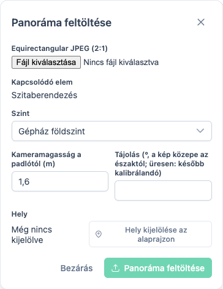

1. Jelölje ki a fában a helyiséget vagy a szintet, amelyhez a panoráma tartozik (pl. *Szivattyútér*), és válassza ki a szintet a térképen.
2. **Panoráma feltöltése** (fényképezőgép ikon).
3. Fájl: **equirectangular JPEG, 2:1 arányban** (a 360°-os kamerák szokásos kimenete).
4. *Kameramagasság a padlótól* (alapból 1,6 m); a *Tájolás* üresen hagyható – később kalibrálható.
5. **Hely kijelölése az alaprajzon** → kattintson a felvétel helyére → **Panoráma feltöltése**.

**Személyes adatok kitakarása**

A rendszer a háttérben arcokat keres a képen. Amíg ez fut, a panoráma állapota *feldolgozásra vár*, utána *kitakarás ellenőrzésre vár* – ilyenkor csak a szerkesztők látják.

1. Nyissa meg a panorámát (a térképen a jelölőjére kattintva, vagy a Fa **Adatok** nézetében).
2. **Ellenőrzés** → a zöld keretek kitakarásra kerülnek; egy téves javaslatra kattintva kizárható (piros), egérrel húzva új terület jelölhető ki.
3. **Jóváhagyás és közzététel** → megerősítés. A kitakart változat elkészülte után a panorámát mindenki látja.

**Tájolás és bejárás**

- **Tájolás kalibrálása** (iránytű ikon): kattintson egy jól azonosítható pontra (ajtó, sarok) a panorámán, majd ugyanarra az alaprajzon. Enélkül az infopontok iránya pontatlan lehet.
- **Szomszédok automatikus összekötése (szint)**: a közeli panorámák között bejárási kapcsolatok jönnek létre. **Kapcsolat be/ki**: egy másik panorámára kattintva a kapcsolat kézzel kapcsolható.

### 6. 3D adatok

*Előkészítés mód, 3D fül → **Új modell**.*

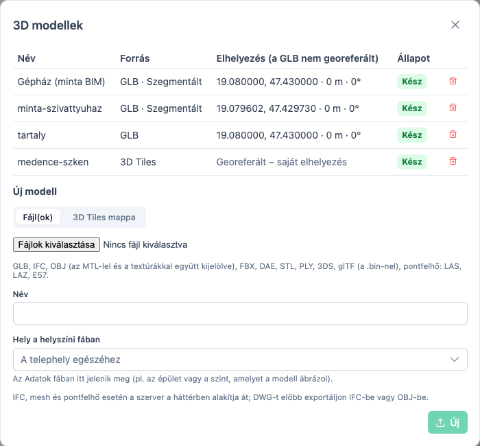

| Mit tölt fel | Mi történik |
|---|---|
| **GLB** | azonnal megjelenik; elhelyezést kell megadni (hosszúság, szélesség, magasság, tájolás) |
| **IFC** (BIM) | a szerver átalakítja; az elemek a GlobalId-jukkal egyenként kijelölhetők és rekordhoz rendelhetők; georeferált IFC magától a helyére kerül |
| **OBJ, FBX, DAE, STL, PLY, 3DS, glTF** | átalakítás után egyben jelenik meg; OBJ-nél az MTL-t és a textúrákat is jelölje ki |
| **LAS, LAZ, E57** (pontfelhő) | átalakítás után pontfelhőként jelenik meg; adja meg a vetületet (pl. `EPSG:23700` – EOV), így a helyére kerül |
| **3D Tiles mappa** | azonnal megjelenik (a mappa gyökerében `tileset.json`) |

1. Válassza ki a fájl(oka)t; a párbeszéd kiírja, minek ismerte fel.
2. **Név**, és **Hely a helyszíni fában** – pl. az épület, amelyet a modell ábrázol (alapból a fában kijelölt helyszíni elem). Ez határozza meg, hol jelenik meg a modell az **Adatok** fában.
3. Feltöltés. Átalakításnál az állapot *Átalakítás…*, majd *Kész* (vagy *Hiba* – az ok a sor fölé víve látszik). A kész modell magától megjelenik a 3D nézetben.

> DWG-t előbb exportáljon IFC-be vagy OBJ-be.

### 7. A berendezések helye

*Előkészítés mód, Fa → Helyszín nézet.*

A helyszíni fában a berendezések (🔗 jellel) a helyük alatt látszanak; akinek még nincs helye, a **Hely nélkül** csoportban van.

- **Áthúzással:** húzza a berendezést a **Hely nélkül** csoportból (vagy egy másik helyiségből) a helyiségre → „*„Befolyó szivattyú 1” helye legyen: Szivattyútér?*” → **Igen**. A funkcionális fában a berendezés a vonala alatt marad.
- **Az adatlapon:** *Helye* → **Hely megadása** listából.
- **Dobozzal:** ha a berendezésnek van doboza a 3D-ben, a helye magától a legkisebb, őt tartalmazó helyiségdoboz (az adatlapon „doboz alapján”). A megadott hely ezt felülírja.

### 8. Megjelenések: infopont, pont, doboz, modellelem

*Összerendelés (vagy Előkészítés) mód.* Minden megjelenésnél ugyanaz a menet: **először jelölje ki a rekordot** (fában vagy táblázatban), utána helyezze el.

**Infopont a panorámán**

1. Nyissa meg a panorámát, jelölje ki a berendezést.
2. **Infopont elhelyezése** (jelölő ikon a panorámán) → kattintson a berendezésre a panorámán → jelölje meg közelítőleg ugyanazt a helyet az alaprajzon.
3. Egy panorámán egy rekordnak egy infopontja van; újra lerakva áthelyeződik.

**Infopontok áthelyezése** (véletlen elmozdítás ellen munkamenetben): **Infopontok áthelyezése** gomb → húzza az infopontokat a panorámán vagy a jelölőket az alaprajzon → a sávon **Mentés** vagy **Elvetés**.

**Pont a 3D-ben:** 3D fül → **Pont lerakása** (jelölő ikon) → kattintson a modellre. Az *Illesztés (m)* mezőben megadott távolságon belül a pont az alaprajz legközelebbi sarkára vagy élére ugrik.

**Doboz (térrész) a 3D-ben** – helyiségeknek és berendezéseknek, ha a modell nem bontható elemekre:

1. 3D fül → **Doboz lerakása** (kocka ikon) → kattintson a berendezésre a modellen.
2. Igazítsa a dobozt a **fogantyúkkal** vagy a panel mezőivel:

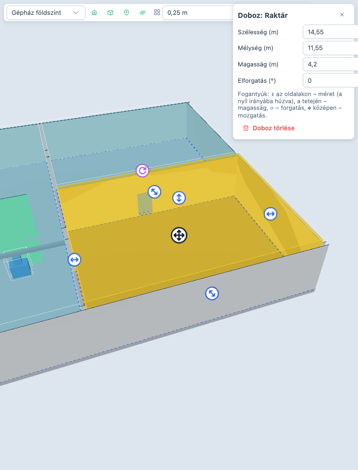

| Fogantyú | Művelet |
|---|---|
| kék kétirányú nyíl az oldalakon | méretezés – a nyíl irányába húzva |
| kék függőleges nyíl a tetején | magasság |
| lila környíl | forgatás |
| sötét négyirányú nyíl középen | mozgatás |

3. A módosítás **piszkozat** marad, amíg a dobozzal dolgozik (*Nem mentett módosítás* jelzés; **Elvetés** visszaállítja). Akkor mentődik, amikor a dobozt elhagyja: bezárja a panelt, vagy más elemet jelöl ki.

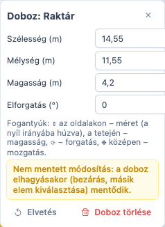

Vonalas elemhez (csővezeték) több doboz is tartozhat.

**Dobozok táblázatból** – ha a helyiségek és berendezések befoglaló méretei már megvannak (pl. felmérésből):

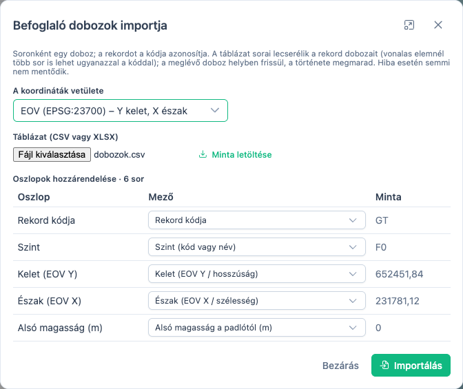

1. Táblázat fül vagy 3D fül → **Befoglaló dobozok importja** (táblázatfájl ikon) → **Minta letöltése** ad egy kitöltendő sablont.
2. Válassza ki a vetületet (alapból **EOV**; WGS84 vagy más EPSG-kód is lehet), majd a fájlt; az oszlopok a fejléc alapján rendelődnek hozzá.
3. **Importálás.** Egy rekord sorai **lecserélik** a dobozait (vonalas elemnél több sor ugyanazzal a kóddal). Hibás sornál semmi nem mentődik; a leggyakoribb hiba a felcserélt EOV X és Y („messze esik a telephelytől”).

**Modellelem (IFC-modellnél):** jelölje ki a rekordot → **Modellelem hozzárendelése** (lánc ikon) → kattintson a modell elemére. Egy modellelem egy rekordhoz tartozhat. Összerendelés módban a más rekordhoz rendelt elemek világoskékek, és egy rekord nélküli elemre kattintva a rendszer jelzi, hogy még nincs gazdája.

### 9. Ellenőrzés és véglegesítés

1. **Adatok** fa: minden panoráma és modell a helyén van-e (lásd a [2. részben](#adatok-fa-ugrás-a-panorámára-és-a-modellre)).
2. **Helyszín** fa: üres-e a *Hely nélkül* csoport.
3. Táblázat: a *Horgony* oszlopban látszik, kinek nincs még megjelenése (*Nincs összerendelve*).
4. **Véglegesítés** az adatlapon (lakat ikon): *Érvényes ettől* (pl. az üzembe helyezés napja); egy vonalnál vagy épületnél bejelölhető, hogy *az alatta lévő elemekkel együtt*. A véglegesítés után a rekord változásai indoklással és dátummal az **Előzmények** közé kerülnek.

---

## 2. rész – Az adatok használata

A Karbantartó riasztást kap: „*Befolyó szivattyú 2 – túlmelegedés*”. Megtekintés módban dolgozik.

### Keresés

- **Fa:** a szűrőmezőbe írja be a nevet vagy a kódot (*=P02*); a fa a találatig kinyílik.
- **Táblázat:** válassza ki az adatforrást (pl. *Berendezés*), keressen, vagy szűrjön oszloponként – számoknál `>=5`, `<=10` alakban is. Egy sorra kattintva a rekord kijelölődik.

### Kijelölés minden nézetben

Ha kijelöli a szivattyút, a **térkép** a helyére és szintjére ugrik, a **3D** nézet odarepül, az **adatlap** megnyílik, és ha van infopontja, egy kattintással megnyitható a **panoráma** is. Fordítva is igaz: a térképen, a panorámán vagy a 3D-ben a szivattyúra kattintva a fa és az adatlap követi. Egymásba ágyazott dobozoknál a legkisebb, a kattintást tartalmazó nyer.

### Adatok fa: ugrás a panorámára és a modellre

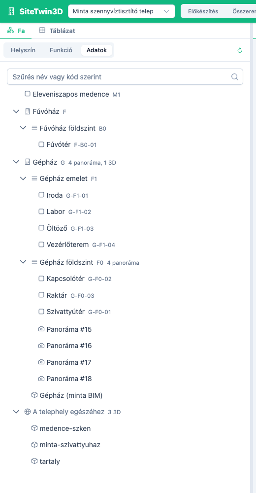

A Fa **Adatok** nézete ugyanaz a helyszíni szerkezet, de az elemek alatt a hozzájuk feltöltött **panorámák** és **3D modellek** látszanak; a sorok mellett a darabszám (*2 panoráma, 1 3D*). Ami nincs helyhez kötve, az *A telephely egészéhez* csoportban van.

- **Panorámára kattintva** a panoráma megnyílik, a térkép a szintjére és helyére áll.
- **Modellre kattintva** a 3D nézet nyílik meg, és a modellre repül.
- Szerkesztő az adatokat **áthúzhatja** másik helyre.

### Panorámabejárás

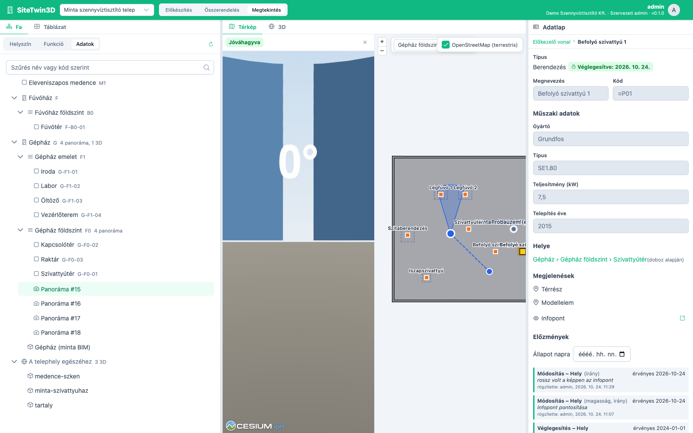

A panorámán egérrel körülnézhet, görgővel nagyíthat. A **navigációs jelek** a szomszédos panorámákra visznek; az **infopontokra** kattintva a berendezés kijelölődik és az adatlapja megnyílik. A térképen a panoráma látószöge is látszik.

A kijelölt elem **befoglaló doboza** a panorámán is megjelenik; ha eltakarja a képet, a panoráma eszköztárának kocka gombjával (*Befoglaló dobozok elrejtése*) kikapcsolható. A böngésző megjegyzi a választást.

### 3D: szintek és funkcionális nézet

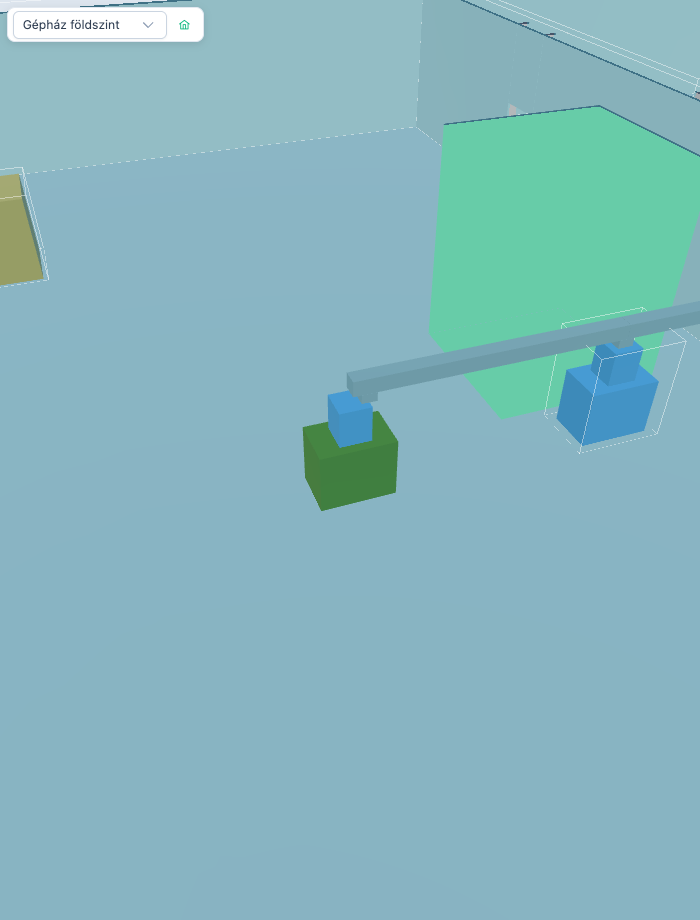

- **Szint kiválasztása** (a 3D eszköztár bal szélén): a modell a szint mennyezete felett le van vágva – belelát az épületbe. *Teljes modell*: vágás nélkül.
- **Ugrás a modellre** (ház ikon): vissza az áttekintéshez.
- Egy **technológiai vonal** kijelölésekor minden berendezése egyszerre kiemelődik – épületeken és szinteken át; *Teljes modell* nézetben a modell áttetszővé válik, a kiemelt elemek a falakon át is látszanak.

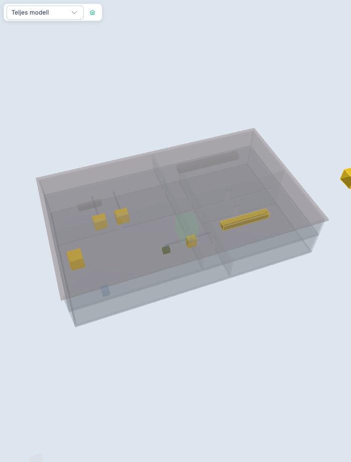

### Adatlap, előzmények, állapot egy napon

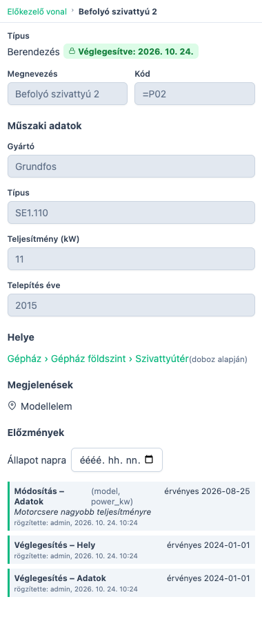

Az adatlapon:

- **Műszaki adatok** (gyártó, típus, teljesítmény …),
- **Helye** (pl. *Gépház › Gépház földszint › Szivattyútér*) – rákattintva a helyiségre ugrik,
- vonalnál, épületnél **Elemek és helyük** – a tagok listája a helyükkel,
- **Megjelenések** – pont, infopont, doboz, modellelem; az infopontnál *Megnyitás* a panorámát nyitja,
- véglegesített rekordnál **Előzmények**: ki, mikor, mit, miért módosított, és mettől érvényes; az **Állapot napra** mezőben egy múltbeli nap kiválasztásával megnézhető, milyen volt a rekord akkor (pl. milyen motor volt a szivattyúban tavaly).

---

## Véglegesített adat módosítása

Véglegesített rekordnál (adatlap: *Véglegesítve*) minden módosításnál – adat, hely, doboz, infopont – a rendszer megkérdezi:

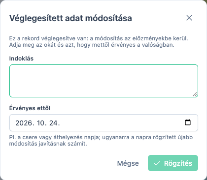

- **Indoklás** – pl. „Motorcsere nagyobb teljesítményűre”.
- **Érvényes ettől** – a valóságos esemény napja (pl. a csere napja). Ugyanarra a napra rögzített újabb módosítás javításnak számít.

**Rögzítés** után a változás az Előzmények közé kerül; **Mégse** esetén nem mentődik. Doboz igazításánál a kérdés csak egyszer jön, amikor a dobozt elhagyja; táblázatos importnál egyszer az egész importra.

## Gyakori kérdések

**Nem tudok szintet létrehozni.** A szintnél kötelező a *Padlómagasság az alapmagasságtól* mező; amíg üres, a *Létrehozás* gomb nem aktív.

**Nem látom a szerkesztő gombokat.** Ellenőrizze az üzemmódot a fejlécben (Előkészítés vagy Összerendelés), és hogy van-e szerkesztési joga ehhez a telephelyhez.

**A panorámát csak én látom.** A kitakarás még nincs jóváhagyva: *Ellenőrzés* → *Jóváhagyás és közzététel*.

**A modell nem jelenik meg.** Átalakítás közben az állapot *Átalakítás…* – kész állapotban magától megjelenik. *Hiba* esetén a modellek listájában a sor fölé víve látszik az ok.

**A 3D-ben a modell „le van vágva”.** Ki van választva egy szint; válassza a *Teljes modell*-t.

**Az infopontok rossz irányba mutatnak.** A panoráma tájolása nincs kalibrálva: *Tájolás kalibrálása*.

**A dobozimport szerint a pont messze van a telephelytől.** Az EOV-ban az Y a keleti (kb. 400 000–950 000), az X az északi (kb. 40 000–370 000) koordináta – valószínűleg fel vannak cserélve.

**A MapManager nem érhető el.** A panorámák, a 3D és a saját adatok működnek; az alaprajz-háttér és a MapManagerből kötött adatok ilyenkor hiányoznak – a felület jelzi.

---

## Függelék: táblázatsablonok és fájlformátumok

**Műszaki adatok importja (CSV/XLSX)** – típusonként, egy sor egy rekord:

```
Kód;Megnevezés;Gyártó;Típus;Teljesítmény (kW);Telepítés éve
=P01;Befolyó szivattyú 1;Grundfos;SE1.80;7,5;2015
=P02;Befolyó szivattyú 2;Grundfos;SE1.80;7,5;2015
```

**Befoglaló dobozok importja (CSV/XLSX)** – egy sor egy doboz (a *Minta letöltése* gomb ugyanezt adja):

```
Rekord kódja;Szint (kód vagy név);Kelet (EOV Y / hosszúság);Észak (EOV X / szélesség);Alsó magasság a padlótól (m);Szélesség (m);Mélység (m);Magasság (m);Elforgatás (°, északtól)
G-F0-01;F0;652451,84;231781,12;0;8;6;4,5;0
=P01;F0;652450,84;231782,12;0;1,2;0,8;1;15
```

- A szélesség 0° elforgatásnál kelet–nyugat, a mélység észak–dél irányú; az elforgatás az óramutató járásával egyező, északtól.
- Az *Alsó magasság* üresen 0 (a doboz a padlón áll).
- Tizedesvessző és tizedespont is használható; CSV-ben pontosvessző, vessző vagy tabulátor az elválasztó.

**Panoráma:** equirectangular JPEG, 2:1 arány (pl. 8192 × 4096).

**3D:** GLB, IFC, OBJ (+MTL, textúrák), FBX, DAE, STL, PLY, 3DS, glTF (+.bin), LAS, LAZ, E57, 3D Tiles mappa.
